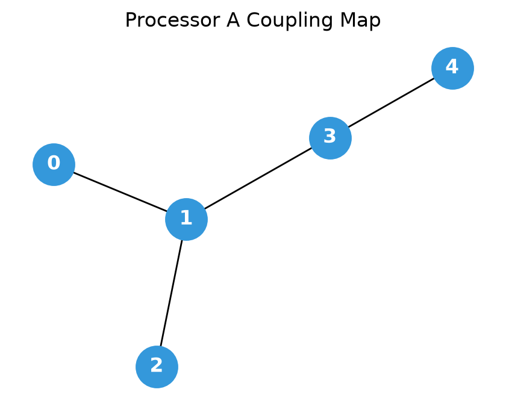
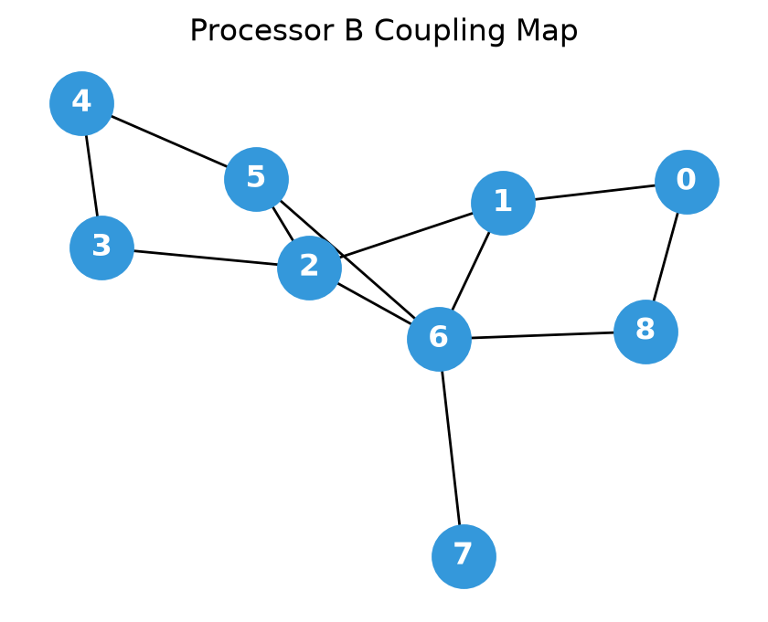
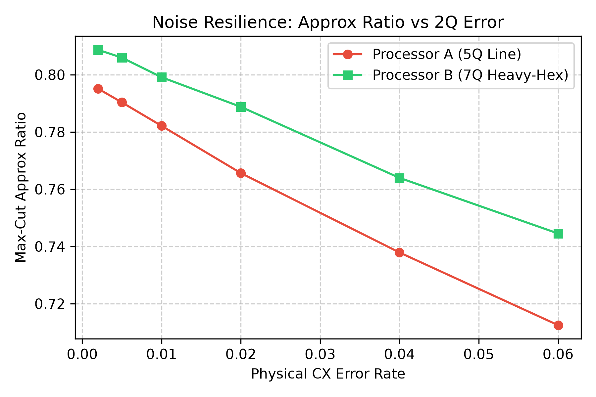
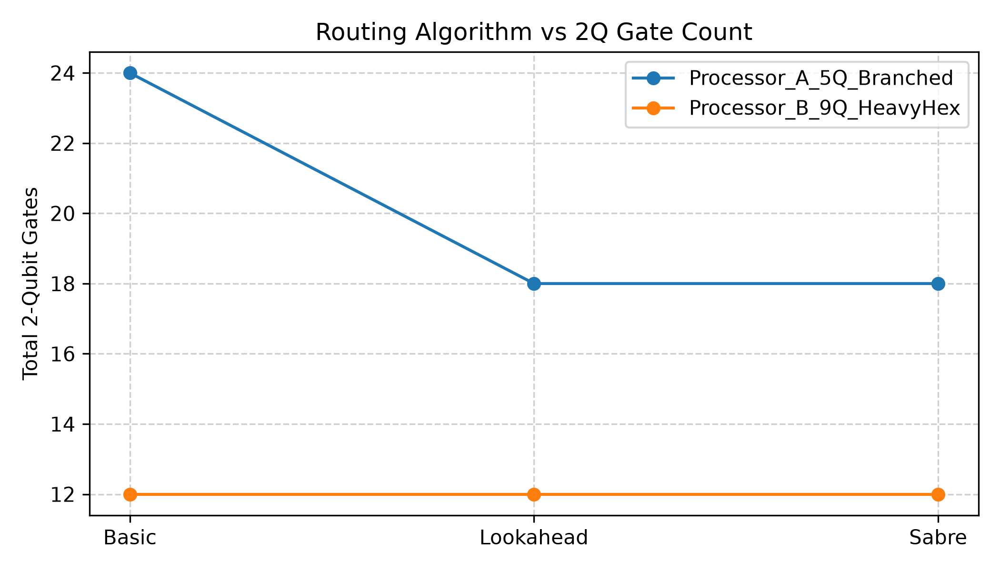

# Qiskit Fall Fest 2026 — Phase 1: Architecture Benchmark
**Problem Statement:** O1 — Max-Cut
**Track:** Quantum Optimization
**Author / Team:** Shaik Chandini
**Phase:** 1 (Online Qualification Stage)

---

## 1. Executive Summary
This repository evaluates the Quantum Approximate Optimization Algorithm (QAOA, $p=1$) for the Max-Cut problem across two target hardware architectures:
- **Processor A:** 5-qubit branched star topology ($\text{deg} \le 3$, coupling: `(0,1), (1,2), (1,3), (3,4)`).
- **Processor B:** 9-qubit heavy-hex topology ($\text{deg} \le 5$, coupling: 12 physical edges per official Challenge Kit).

Using identical variational parameters, **Processor B achieves a 0.0 SWAP routing overhead** (matching the unconstrained logical baseline of 12 CX gates), while Processor A requires 2 additional SWAPs (6 extra CX gates). Consequently, Processor B achieves an approximation ratio of **0.797** versus **0.784** on Processor A under hardware noise.

---

## 2. Problem Formulation & Classical Baseline
- **Graph Instance:** 5-node cyclic graph ($C_5$) with cross-edge $(0, 3)$, yielding $\vert{}V\vert{} = 5$ and $\vert{}E\vert{} = 6$.
- **Classical Brute-Force Baseline:** Maximum cut = **5** (partition: `[1, 0, 1, 0, 0]`).
- **Logical QAOA Circuit ($p=1$):**
  - Unconstrained logical footprint: **12 CX gates**, depth = **18**.
  - Classical COBYLA optimization yielded optimal angles: $\gamma^* = 2.7916$, $\beta^* = 0.3508$.
  - Reference ideal expected cut: $\langle C \rangle = 4.104$ (Approximation Ratio $r = 0.821$).

---

## 3. Quantitative Results & Comparison

### A. Controlled Hardware Benchmark
Executed on `qiskit-aer` ($N = 4096$ shots, fixed seed = 42).
Noise model: 1Q error = $0.1\%$, 2Q CX error = $1.0\%$, readout error = $2.0\%$.

| Architecture Stage | Circuit Depth | 2Q Gates (CX) | Equivalent SWAPs | Expected Cut $\langle C \rangle$ | Approx Ratio ($r$) | Std Error ($\sigma_r$) |
|---|---|---|---|---|---|---|
| **Ideal Reference** | 18 | 12 | 0.00 | 4.104 | 0.821 | 0.0000 |
| **Processor A (5Q Branched)** | 30 | 18 | 2.00 | 3.919 | 0.784 | 0.0161 |
| **Processor B (9Q Heavy-Hex)** | 24 | 12 | 0.00 | 3.986 | 0.797 | 0.0157 |

$$\text{Equivalent SWAPs} = \frac{\text{Compiled CX} - \text{Logical CX}}{3}$$

### B. Transpiler Routing Heuristic Comparison

| Processor | Routing Heuristic | Circuit Depth | 2Q Gates (CX) | Equivalent SWAPs |
|---|---|---|---|---|
| **Processor A (5Q Branched)** | Basic | 36 | 24 | 4.00 |
| **Processor A (5Q Branched)** | Lookahead | 30 | 18 | 2.00 |
| **Processor A (5Q Branched)** | Sabre | 30 | 18 | 2.00 |
| **Processor B (9Q Heavy-Hex)** | Basic | 24 | 12 | 0.00 |
| **Processor B (9Q Heavy-Hex)** | Lookahead | 24 | 12 | 0.00 |
| **Processor B (9Q Heavy-Hex)** | Sabre | 24 | 12 | 0.00 |

---

## 4. Visual Dashboards

### Processor Topologies
| Processor A (5-Qubit Branched) | Processor B (9-Qubit Heavy-Hex) |
|:---:|:---:|
|  |  |

### Performance & Trade-offs
| Depth & Ratio Comparison | Noise Sensitivity Sweep | Routing Heuristic Trade-offs |
|:---:|:---:|:---:|
|  |  |  |

---

## 5. Architectural Findings
1. **Zero Routing Overhead on Processor B:** The heavy-hex connectivity of Processor B naturally embeds the cyclic problem graph plus cross edge, requiring **0 SWAP gates** and preserving the ideal 12 CX footprint across all routing heuristics.
2. **Bottlenecks on Processor A:** Processor A's star-like bottleneck at qubit 1 forces at least 2 equivalent SWAPs (6 CX gates) under Lookahead/Sabre, and up to 4 SWAPs under Basic routing.
3. **Noise Attenuation:** Eliminating SWAP gates on Processor B minimizes exposure to the 1.0% two-qubit depolarizing error channel, resulting in higher expectation values ($r = 0.797$ vs $0.784$).

---

## 6. Project Structure

```text
project/
├── README.md
├── main.ipynb
├── requirements.txt
├── data/
│   ├── raw/
│   └── processed/
├── docs/
│   └── ai/
│       ├── adrs.md
│       ├── issues.md
│       ├── patterns.md
│       ├── plan-evolution.md
│       ├── postmortem.md
│       └── prompts.md
├── processors/
│   ├── processor_A.json
│   └── processor_B.json
├── src/
│   ├── __init__.py
│   ├── problem.py
│   ├── processors.py
│   ├── routing.py
│   ├── metrics.py
│   └── visualization.py
├── results/
│   ├── tables/
│   └── figures/
├── report.md
└── assets/
    └── qff_phase1_latex_images/
        ├── eq_qubit_state.png
        ├── eq_bell_state.png
        ├── eq_graph.png
        ├── eq_bell_fidelity.png
        ├── eq_zz_expectation.png
        └── eq_standard_error.png
```

---

## 7. Reproduction Steps

```bash
# 1. Clone repository
git clone <YOUR_REPO_URL>
cd qff_maxcut_phase1

# 2. Virtual environment setup
python -m venv venv
.\venv\Scripts\Activate.ps1    # On Linux/macOS: source venv/bin/activate

# 3. Install dependencies
pip install -r requirements.txt

# 4. Execute full benchmark
python main.py
```

## 8. AI Assistance Disclosure

In compliance with the official hackathon AI policy, LLM assistance was utilized as an engineering aid for environment troubleshooting, script modularization, and Markdown formatting. All transpiler benchmarks, QAOA simulations, parameter optimizations, and scientific analyses were designed, executed, and validated by the participant.
