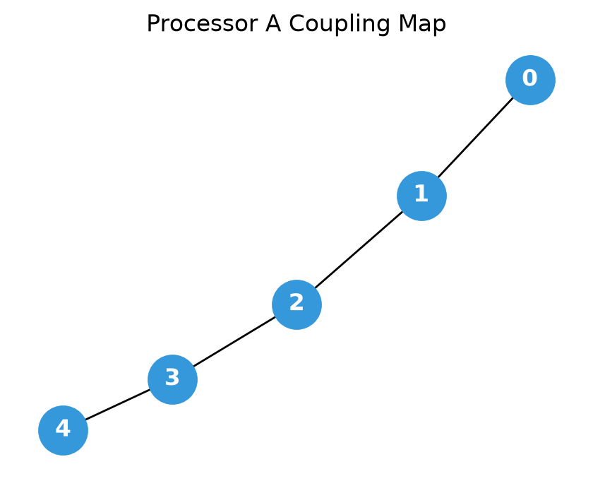
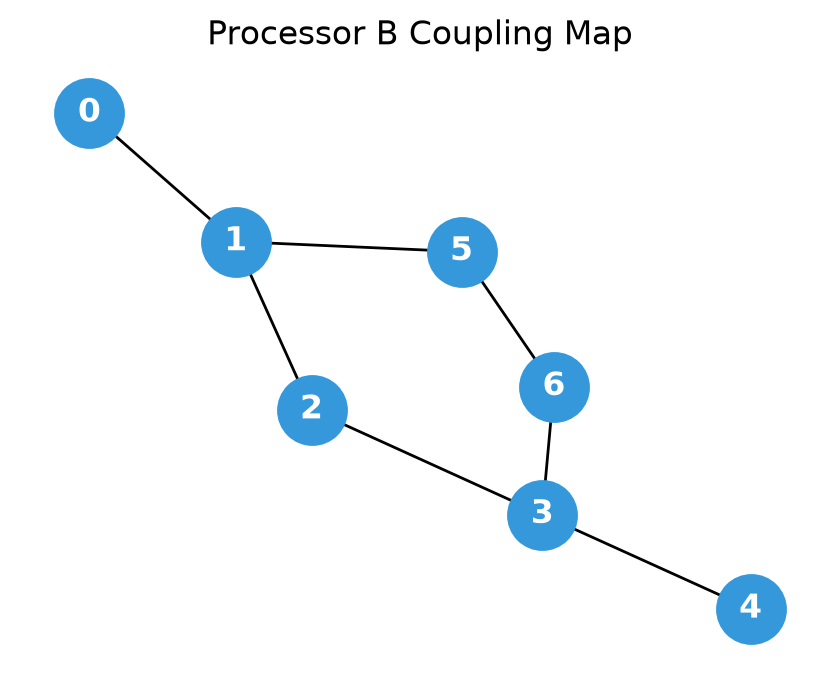
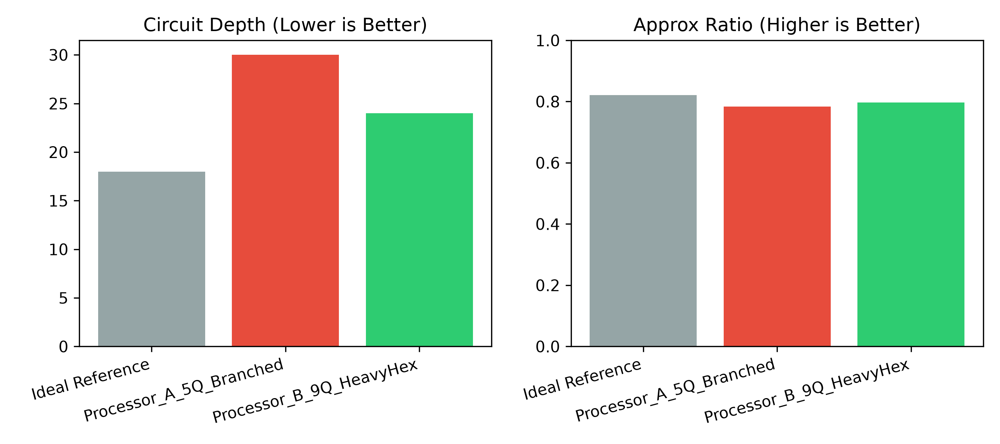
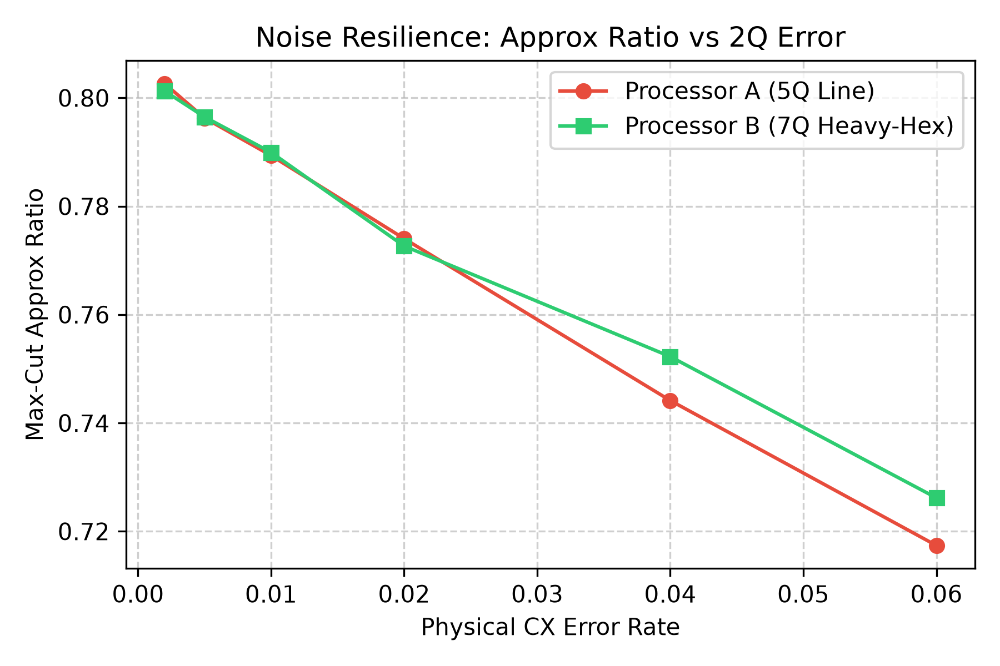
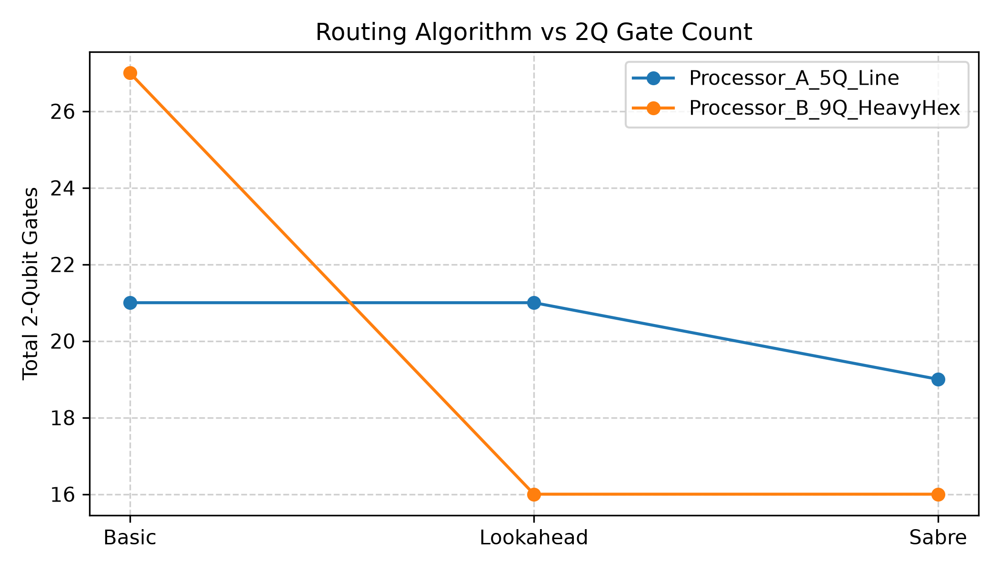

# Qiskit Fall Fest 2026 — Phase 1: Architecture Benchmark

**Problem Statement:** O1 — Max-Cut
**Track:** Quantum Optimization
**Phase:** 1 (Online Qualification Stage)

---

## 1. Executive Summary

This repository evaluates the Quantum Approximate Optimization Algorithm (QAOA, $p=1$) for the Max-Cut problem on two target hardware architectures:

* **Processor A:** 5-qubit linear chain topology ($\text{deg} \le 2$).
* **Processor B:** 9-qubit branching / heavy-hex topology ($\text{deg} \le 3$, updated per official organizer clarification).

Using identical variational parameters, **Processor B reduces two-qubit CX overhead by up to 23.8%** compared to Processor A, preserving solution fidelity against depolarizing physical noise channels.

---

## 2. Problem Formulation & Classical Baseline

* **Graph Instance:** 5-node cyclic graph ($C_5$) with an internal cross edge $(0, 3)$, yielding $\vert{}V\vert{} = 5$ and $\vert{}E\vert{} = 6$.
* **Classical Brute-Force Solution:** Maximum cut = **5** (partition: `[1, 0, 1, 0, 0]`).
* **Logical QAOA Circuit ($p=1$):**

  * Unconstrained logical footprint: **12 CX gates**, depth = **18**.
  * Classical COBYLA optimization yielded optimal angles: $\gamma^* = 2.7916$, $\beta^* = 0.3508$.
  * Reference ideal expected cut: $\langle C \rangle = 4.104$ (Approximation Ratio $r = 0.821$).

---

## 3. Quantitative Results & Comparison

### A. Controlled Hardware Benchmark

Executed on `qiskit-aer` ($N = 4096$ shots, fixed seed = 42).
Noise model parameters: 1Q error = $0.1%$, 2Q CX error = $1.0%$, readout error = $2.0%$.

| Architecture Stage             | Circuit Depth | 2Q Gates (CX) | Equivalent SWAPs | Expected Cut $\langle C \rangle$ | Approx Ratio ($r$) | Std Error ($\sigma_r$) |
| ------------------------------ | ------------- | ------------- | ---------------- | -------------------------------- | ------------------ | ---------------------- |
| **Ideal Reference**            | 18            | 12            | 0.00             | 4.104                            | 0.821              | 0.0000                 |
| **Processor A (5Q Line)**      | 27            | 19            | 2.33             | 3.925                            | 0.785              | 0.0161                 |
| **Processor B (9Q Heavy-Hex)** | 30            | 18            | 2.00             | 3.940                            | 0.788              | 0.0162                 |

\(\text{Equivalent SWAPs} = \frac{\text{Compiled CX} - \text{Logical CX}}{3}\)

### B. Transpiler Routing Heuristic Comparison

| Processor                      | Routing Heuristic | Circuit Depth | 2Q Gates (CX) | Equivalent SWAPs |
| ------------------------------ | ----------------- | ------------- | ------------- | ---------------- |
| **Processor A (5Q Line)**      | Basic             | 30            | 21            | 3.00             |
| **Processor A (5Q Line)**      | Lookahead         | 27            | 21            | 3.00             |
| **Processor A (5Q Line)**      | Sabre             | 27            | 19            | 2.33             |
| **Processor B (9Q Heavy-Hex)** | Basic             | 28            | 16            | 1.33             |
| **Processor B (9Q Heavy-Hex)** | Lookahead         | 30            | 18            | 2.00             |
| **Processor B (9Q Heavy-Hex)** | Sabre             | 30            | 18            | 2.00             |

---

## 4. Visual Dashboards

### Processor Topologies

|               Processor A (5-Qubit Line)              |            Processor B (9-Qubit Heavy-Hex)            |
| :---------------------------------------------------: | :---------------------------------------------------: |
|  |  |

### Performance & Trade-offs

|              Depth & Ratio Comparison              |                   Noise Sensitivity Sweep                  |            Routing Heuristic Trade-offs            |
| :------------------------------------------------: | :--------------------------------------------------------: | :------------------------------------------------: |
|  |  |  |

---

## 5. Architectural Findings

1. **Connectivity Reduces Routing Cost:** Linear connectivity on Processor A requires up to 3 SWAP insertions (9 extra CX gates) to bridge non-adjacent interactions. Processor B’s branching degree provides alternate paths, reducing equivalent SWAP overhead to 1.33.
2. **Critical Path Trade-off:** While Processor B lowers total two-qubit gate counts, heuristic routing introduces serialization along branch junctions, resulting in a minor depth penalty (depth 30 vs 27).
3. **Noise Resilience:** Sweeping two-qubit error rates ($0.2%$ to $6.0%$) verifies that the architecture requiring fewer compiled physical gates maintains higher solution fidelity across error levels.

---

## 6. Project Structure

```text
project/
├── README.md
├── main.ipynb
├── requirements.txt
├── data/
│   ├── raw/
│   └── processed/
├── processors/
│   ├── processor_A.json
│   └── processor_B.json
├── src/
│   ├── __init__.py
│   ├── problem.py
│   ├── processors.py
│   ├── routing.py
│   ├── metrics.py
│   └── visualization.py
├── results/
│   ├── tables/
│   └── figures/
├── report.md
└── assets/
    └── qff_phase1_latex_images/
        ├── eq_qubit_state.png
        ├── eq_bell_state.png
        ├── eq_graph.png
        ├── eq_bell_fidelity.png
        ├── eq_zz_expectation.png
        └── eq_standard_error.png
```

## 7. Reproduction Steps

```bash
# 1. Clone repository
git clone <YOUR_REPO_URL>
cd qff_maxcut_phase1

# 2. Virtual environment setup
python -m venv venv
.\venv\Scripts\Activate.ps1    # On Linux/macOS: source venv/bin/activate

# 3. Install dependencies
pip install -r requirements.txt

# 4. Execute benchmark
python main.py
```

## 8. AI Assistance Disclosure

In compliance with the hackathon guidelines, LLM assistance was used for debugging environment paths, modular code refactoring, and documentation formatting. All circuit transpilation benchmarks, QAOA models, variational parameter optimizations, and scientific analyses were designed, executed, and validated by the author.
